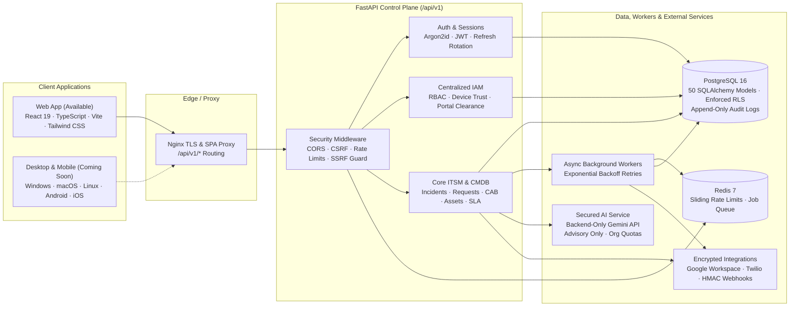

# SCRIBBLE-IT

**Enterprise IT Management. Open to Everyone.**

**Developed by NEEREJ S SURESAN**  
Founder & CEO — Njure Tech (formally Njure Group).

Official Website: [https://scribbleit.njuregroup.in](https://scribbleit.njuregroup.in)  
Njure Tech: [https://tech.njuregroup.in](https://tech.njuregroup.in) · Njure Group (Former): [https://njuregroup.in](https://njuregroup.in)  
Repository: [https://github.com/neerejsuresan-njuretech/Scribble-IT-Test](https://github.com/neerejsuresan-njuretech/Scribble-IT-Test)  
License: `AGPL-3.0-only WITH Appstore-exception` ([LICENSE](./LICENSE) · [LICENSE-EXCEPTION.md](./LICENSE-EXCEPTION.md))


---

## Table of Contents

1. [Project Overview](#1-project-overview)
2. [Why Scribble-IT](#2-why-scribble-it)
3. [Core Capabilities](#3-core-capabilities)
4. [Platform Architecture](#4-platform-architecture)
5. [Cross-Platform Ecosystem](#5-cross-platform-ecosystem)
6. [Technology Stack](#6-technology-stack)
7. [Repository Structure](#7-repository-structure)
8. [Screenshots & Visual Previews](#8-screenshots--visual-previews)
9. [Quick Start](#9-quick-start)
10. [Frontend Setup](#10-frontend-setup)
11. [Backend Setup](#11-backend-setup)
12. [Database & Migrations](#12-database--migrations)
13. [Docker & Self-Hosting](#13-docker--self-hosting)
14. [Environment Configuration](#14-environment-configuration)
15. [Authentication, IAM & Security](#15-authentication-iam--security)
16. [AI Integration & Governance Boundaries](#16-ai-integration--governance-boundaries)
17. [External Integrations](#17-external-integrations)
18. [Testing & Verification](#18-testing--verification)
19. [API & Documentation Index](#19-api--documentation-index)
20. [Roadmap](#20-roadmap)
21. [Contributing](#21-contributing)
22. [Community](#22-community)
23. [Security Policy](#23-security-policy)
24. [Support & Sponsorship](#24-support--sponsorship)
25. [Licensing](#25-licensing)
26. [Founder & Organization](#26-founder--organization)
27. [Acknowledgements & Philosophy](#27-acknowledgements--philosophy)
28. [Project Identity Summary](#28-project-identity-summary)

---

## 1. Project Overview

**SCRIBBLE-IT** is an open-source, community-driven Enterprise IT Service Management (ITSM) platform built by **Njure Tech (formally Njure Group)**. It unifies incident management, service requests, problem investigation, Change Advisory Board (CAB) governance, Configuration Management Database (CMDB), asset and license tracking, centralized Identity and Access Management (IAM), workflow automation, and human-supervised AI assistance in one self-hostable platform.

The platform operates across four role-separated portals:

- **Super Admin Portal** — Multi-organization governance, Watchtower operations, module flags, and platform controls.
- **IAM Portal** — User directory, RBAC policy management, device enrollment, trusted device SSO, and session revocation.
- **Employee Operations Portal** — ITIL queues for incidents, service requests, problems, changes, CMDB, inventory, telephony, and workflows.
- **End-User Self-Service Portal** — Service catalog requests, ticket tracking, knowledge base lookup, and status updates.

---

## 2. Why Scribble-IT

Enterprise IT teams frequently face high per-agent licensing fees, closed proprietary ecosystems, and disconnected operational tools. SCRIBBLE-IT addresses these gaps with:

- **100% Free & Open Source** under GNU AGPL v3.0 with an explicit Section 7 App Store Distribution Exception.
- **Full Data Sovereignty** via Docker Compose self-hosting and PostgreSQL 16 Row-Level Security (RLS).
- **Backend-Enforced Security** with Argon2id hashing, rotating refresh tokens, server-computed RBAC, and append-only audit logs.
- **Human-First AI Operations** where Gemini-powered triage and risk insights advise operators without ever executing autonomous governance actions.

---

## 3. Core Capabilities

| Domain | Capabilities | Status |
| :--- | :--- | :--- |
| **IT Service Management** | Incident Management, Service Request Management & Catalog, Problem Management & Known Errors, Change Management & CAB Voting, SLA Tracking, Knowledge Base | Available |
| **Configuration & Asset Management** | Asset Lifecycle Management, CMDB Dependency Mapping, IT Inventory Stockrooms, Software License Tracking | Available |
| **Identity & Access Management** | Centralized Auth (Argon2id + JWT), Granular RBAC & Portal Clearance, Device Trust & Enrollment Codes, Session Management, MFA Foundations, Trusted Device SSO | Available |
| **Automation & AI** | Visual Pre-Close Workflow Mapper, Multi-Step Workflow Builder, AI-Assisted Incident Triage, AI Change Risk Insights, AI Knowledge Generation & ITSM Copilot | Available |
| **Enterprise Governance** | Multi-Organization PostgreSQL RLS Isolation, Multi-Stage Approval Workflows, Immutable Append-Only Audit Logs, Operational Reporting & Watchtower Analytics | Available |
| **External Integrations** | Google Workspace (Drive, Sheets, Forms, Chat), Telephony & Twilio Programmable Voice, Signed HMAC Webhooks, Retry Background Workers | Available |
| **Extensibility** | Standardized Plugin & Community Add-on SDK | Planned |

---

## 4. Platform Architecture



---

## 5. Cross-Platform Ecosystem

| Platform | Target Environments | Current Status |
| :--- | :--- | :--- |
| **Web Application** | Modern Desktop & Mobile Browsers | **Available** |
| **Desktop Applications** | Windows, macOS, Linux | **Coming Soon** (architecture audited; no installers published yet) |
| **Mobile Applications** | Android, iOS | **Coming Soon** (architecture audited; no store builds published yet) |

See [docs/architecture/repository-audit.md](./docs/architecture/repository-audit.md) for the cross-platform architectural analysis.

---

## 6. Technology Stack

- **Frontend (Implemented):** React 19, TypeScript, Vite 8, Tailwind CSS v4, React Router v7, Lucide React
- **Backend (Implemented):** Python 3, FastAPI (`0.115.6`), Uvicorn, Pydantic v2, SQLAlchemy 2.x Async, Alembic, AsyncPG, Psycopg 3
- **Data & Messaging (Implemented):** PostgreSQL 16 (with Row-Level Security), Redis 7, Async Python Worker Runner
- **Security & Cryptography (Implemented):** `argon2-cffi`, `PyJWT[crypto]`, `cryptography` (Fernet at-rest secret encryption)
- **Infrastructure & CI (Implemented):** Docker, Docker Compose, Nginx, GitHub Actions (`.github/workflows/backend-ci.yml`, `.github/workflows/deploy-pages.yml`)
- **Cross-Platform Shared Packages & Store Pipelines:** Planned

---

## 7. Repository Structure

```text
.
├── backend/                     # FastAPI core backend, SQLAlchemy models, Alembic migrations, workers, pytest suite
│   ├── alembic/                 # Database migration scripts & env.py
│   ├── app/                     # API routers (/api/v1), services, repositories, security, AI, integrations, workers
│   ├── scripts/                 # Migration & operational utility scripts (including Firebase-to-PostgreSQL migrator)
│   ├── tests/                   # Backend pytest test suite
│   ├── Dockerfile               # Backend container image definition
│   └── requirements.txt         # Pinned Python dependencies
├── docs/                        # Technical documentation
│   ├── api/                     # REST API v1 reference
│   ├── architecture/            # Repository & cross-platform audit
│   └── deployment/              # Backend foundation, self-hosted, and production cloud deployment guides
├── infrastructure/              # Docker web Dockerfile, Nginx configs, and PostgreSQL role bootstrap script
├── src/                         # React + TypeScript frontend application
│   ├── assets/images/           # Verified local visual assets
│   ├── components/              # Modular ITSM, IAM, workflow, telephony, and public website components
│   ├── config/                  # Centralized open-source URLs & project identity (openSourceConfig.ts)
│   ├── context/                 # Application state and auth/API adapters
│   ├── pages/                   # Operational portals and public overview page
│   └── utils/                   # API client, navigation RBAC helpers, and formatters
├── tests/frontend/              # Frontend Node/tsx unit tests (navigation RBAC & API client)
├── docker-compose.yml           # Local & self-hosted stack (PostgreSQL, Redis, Migrator, Backend, Worker, Web)
├── docker-compose.prod.yml      # Production hardened compose overrides
├── server.ts                    # Local Express + Vite dev/runtime entry point (port 3000)
├── LICENSE                      # GNU AGPL v3.0 license text
├── LICENSE-EXCEPTION.md         # Section 7 App Store Distribution Exception
├── CONTRIBUTING.md              # Contribution guidelines
└── security_spec.md             # Security architecture specification
```

---

## 8. Screenshots & Visual Previews

| Operational Dashboard & Command View | Visual Workflow & Process Blueprints |
| :---: | :---: |
|  |  |

| Service Desk & Telephony CTI | CMDB Infrastructure & Hardware Security |
| :---: | :---: |
|  |  |

---

## 9. Quick Start

### Prerequisites

- **Node.js 24.12.0+** (required by Firebase SDK 13.x & verified in CI) and `npm`
- **Python 3.11+** (for local FastAPI backend development)
- **Docker & Docker Compose** (recommended for running PostgreSQL 16, Redis 7, migrations, API, and workers together)

### Run the Frontend Locally

```bash
git clone https://github.com/neerejsuresan-njuretech/Scribble-IT-Test.git
cd Scribble-IT-Test
cp .env.example .env
npm install
npm run dev
```

The application serves on `http://localhost:3000`.

### Shared Workspaces & Brand Verification

- `packages/types` (`@scribble-it/types`), `packages/api-client` (`@scribble-it/api-client`), `packages/rbac` (`@scribble-it/rbac`), and `packages/design-tokens` (`@scribble-it/design-tokens`) form the shared cross-platform TypeScript core. See [docs/architecture/shared-packages.md](docs/architecture/shared-packages.md).
- Official SCRIBBLE-IT brand assets, locally bundled SIL OFL 1.1 Inter/Manrope fonts, and Windows/macOS/Linux/Android/iOS icon packages live under `assets/brand/`. See [docs/brand/brand-asset-guide.md](docs/brand/brand-asset-guide.md) and [docs/brand/platform-icon-specifications.md](docs/brand/platform-icon-specifications.md).
- Validate workspaces & brand assets locally via `npm run typecheck:packages`, `npm run test:frontend`, and `npm run verify:brand`.

---

## 10. Frontend Setup

Available npm scripts defined in `package.json`:

```bash
npm install          # Install frontend dependencies
npm run dev          # Start Express + Vite dev server on port 3000
npm run build        # Build production Vite bundle into dist/
npm run build:pages  # Build static bundle with VITE_BASE_PATH=./
npm run lint         # Type-check codebase via tsc --noEmit
npm run preview      # Preview production Vite build
```

To connect the frontend directly to a running SCRIBBLE-IT FastAPI backend, set in `.env`:

```env
VITE_API_BASE_URL="http://localhost:8000"
VITE_USE_BACKEND_API="true"
```

---

## 11. Backend Setup

```bash
cd backend
python3 -m venv .venv
source .venv/bin/activate
pip install -r requirements.txt
```

Start the FastAPI API server and async background worker (after configuring PostgreSQL, Redis, and `.env`):

```bash
# Terminal 1 — FastAPI API
uvicorn app.main:app --host 0.0.0.0 --port 8000

# Terminal 2 — Async Background Worker
python -m app.workers.runner
```

Health endpoints:

- `GET /api/v1/health/live` — Liveness probe
- `GET /api/v1/health/ready` — Readiness probe (verifies database & Redis connectivity)

---

## 12. Database & Migrations

SCRIBBLE-IT enforces strict PostgreSQL role separation:

- **`scribble_migrator`** — Used exclusively by Alembic (`MIGRATION_DATABASE_URL`) for DDL migrations.
- **`scribble_app`** — Restricted `NOSUPERUSER` / `NOBYPASSRLS` runtime role (`DATABASE_URL`) ensuring Row-Level Security policies are always enforced.

Bootstrap database roles and apply Alembic migrations:

```bash
# 1. Role initialization (executed automatically by Docker Postgres entrypoint)
bash infrastructure/postgres/init-roles.sh

# 2. Apply schema migrations from backend/
cd backend
alembic upgrade head
```

---

## 13. Docker & Self-Hosting

Start PostgreSQL 16, Redis 7, the one-shot Alembic migrator, the FastAPI backend, and the background worker:

```bash
cp .env.example .env
# Edit .env to set strong POSTGRES_*_PASSWORD, JWT_SECRET_KEY, and INTEGRATION_ENCRYPTION_KEY values
docker compose up -d --build
```

To include the Nginx web container (`web` profile) and production hardening overrides:

```bash
docker compose -f docker-compose.yml -f docker-compose.prod.yml --profile web up -d --build
```

Detailed guides:

- [Self-Hosted Deployment Guide](./docs/deployment/self-hosted-guide.md)
- [Production Cloud Deployment Guide](./docs/deployment/production-cloud-guide.md)
- [Backend Foundation Guide](./docs/deployment/backend-foundation.md)

---

## 14. Environment Configuration

All configuration keys are documented in [`.env.example`](./.env.example). Core variables include:

| Variable | Purpose | Scope |
| :--- | :--- | :--- |
| `DATABASE_URL` | Async PostgreSQL runtime DSN (`scribble_app`, non-superuser) | Backend only |
| `MIGRATION_DATABASE_URL` | Sync PostgreSQL Alembic DSN (`scribble_migrator`) | Migrator only |
| `REDIS_URL` | Redis 7 cache, rate limiter, and worker broker DSN | Backend & Worker |
| `JWT_SECRET_KEY` | Signing secret for JWT access tokens (min 32+ chars in prod) | Backend only |
| `INTEGRATION_ENCRYPTION_KEY` | Fernet key for encrypting stored integration secrets | Backend only |
| `GEMINI_API_KEY` | Optional Gemini API key for backend-proxied AI services | Backend only |
| `AI_RATE_LIMIT_PER_MINUTE` / `AI_DAILY_ORG_LIMIT` | Per-minute & per-organization daily AI quotas | Backend only |
| `CORS_ALLOWED_ORIGINS` | Allowed browser origins for FastAPI CORS policy | Backend only |
| `VITE_API_BASE_URL` / `VITE_USE_BACKEND_API` | Optional frontend connection to FastAPI `/api/v1` | Frontend build |
| `VITE_BUY_ME_A_COFFEE_URL`, `VITE_GITHUB_SPONSORS_URL`, `VITE_COMMUNITY_URL`, `VITE_ROADMAP_URL`, `VITE_CHANGELOG_URL` | Optional public website URL overrides in `src/config/openSourceConfig.ts` | Frontend build |

> **Security Rule:** Never store API keys, database passwords, JWT secrets, or integration tokens in `VITE_*` variables or commit `.env` files to source control.

---

## 15. Authentication, IAM & Security

- **Password Storage:** Argon2id hashing (`argon2-cffi`); zero plaintext password storage.
- **Token Lifecycle:** Short-lived JWT access tokens (`15m` default) paired with hashed refresh tokens, rotation on refresh, and automatic session-family revocation on token reuse detection.
- **Authorization:** Server-computed effective RBAC permissions and portal clearance checks; client-supplied roles are never trusted.
- **Tenant Isolation:** PostgreSQL 16 Row-Level Security (RLS) scoped per transaction via `SET LOCAL`.
- **Audit Integrity:** Append-only audit tables with `UPDATE` and `DELETE` privileges revoked from the runtime application role.
- **Transport & Egress Controls:** Origin CSRF validation, sliding-window Redis rate limiting, HMAC-SHA256 webhook signature verification with replay window checks, and SSRF egress filtering blocking private/link-local IP ranges.

---

## 16. AI Integration & Governance Boundaries

SCRIBBLE-IT integrates optional Gemini AI assistance exclusively behind authenticated FastAPI endpoints (`/api/v1/ai/*`) for:

- Incident triage recommendations
- Change risk review checklists
- Knowledge article & wiki SOP drafting
- Operational ITSM Copilot queries

**Non-Negotiable Safety Boundaries:**

- Gemini API keys remain backend-only and are never exposed to the browser.
- Every AI invocation checks organization permissions, rate limits, daily quotas, and writes an AI audit record.
- **AI is strictly advisory:** AI services never autonomously approve service requests, cast CAB votes, modify IAM roles/permissions, or execute Super Admin governance actions.

---

## 17. External Integrations

All external connectors operate behind backend adapters with encrypted credentials (`INTEGRATION_ENCRYPTION_KEY`), organization-level permissions, retry workers, and audit logging:

- **Google Workspace:** Drive, Sheets, Forms, and Chat integration adapters.
- **Telephony:** Twilio Programmable Voice bridging and personal mobile CTI softphone workflows.
- **Webhooks & Notifications:** Outbound/inbound HMAC-SHA256 signed webhooks with replay protection and dead-letter/retry tracking.

---

## 18. Testing & Verification

### Frontend Unit & Type Checks

```bash
npm run lint
npx tsx --test tests/frontend/navigation_rbac.test.ts tests/frontend/api_client.test.ts
```

### Backend Test Suite

```bash
cd backend
pytest -v
```

### Production Build Check

```bash
npm run build
```

---

## 19. API & Documentation Index

- [API v1 Reference](./docs/api/api-v1-reference.md)
- [Self-Hosted Deployment Guide](./docs/deployment/self-hosted-guide.md)
- [Production Cloud Deployment Guide](./docs/deployment/production-cloud-guide.md)
- [Backend Foundation Guide](./docs/deployment/backend-foundation.md)
- [Cross-Platform Repository Audit](./docs/architecture/repository-audit.md)
- [GitHub Pages Static Deployment](./GITHUB_PAGES_DEPLOY.md)
- [Security Specification](./security_spec.md)
- [Contributing Guide](./CONTRIBUTING.md)

---

## 20. Roadmap

| Milestone | Status |
| :--- | :--- |
| Core Enterprise ITSM Platform | Completed |
| Enterprise IAM & RBAC Architecture | Completed |
| Backend Migration to FastAPI & PostgreSQL | Completed |
| AI-Assisted ITSM Operations | Completed |
| External Integrations & Automation | Completed |
| Self-Hosted Enterprise Deployment | In Progress |
| Community Ecosystem & Documentation | In Progress |
| Desktop Applications (Windows, macOS, Linux) | Coming Soon |
| Mobile Applications (Android, iOS) | Coming Soon |
| Plugin & Extension Ecosystem | Planned |

---

## 21. Contributing

**BUILT WITH THE COMMUNITY. IMPROVED BY THE COMMUNITY.**

Contributions are welcome across code, bug reports, feature proposals, documentation, testing & QA, UI/UX refinements, translations, community support, and responsible security disclosures.

1. Fork the repository and create a topic branch from `main`.
2. Review [CONTRIBUTING.md](./CONTRIBUTING.md) and [`security_spec.md`](./security_spec.md).
3. Run type-checks (`npm run lint`) and relevant frontend/backend tests before opening a pull request.
4. Open a pull request describing the operational problem solved and verification steps performed.

---

## 22. Community

- **Source Code & Discussions:** [GitHub Repository](https://github.com/neerejsuresan-njuretech/Scribble-IT-Test)
- **Issue Tracker:** [GitHub Issues](https://github.com/neerejsuresan-njuretech/Scribble-IT-Test/issues)
- **Dedicated Community Portal:** *Placeholder — configure `COMMUNITY_URL` in [`src/config/openSourceConfig.ts`](./src/config/openSourceConfig.ts) when launched.*
- **Dedicated Roadmap / Changelog URLs:** *Placeholders — configure `ROADMAP_URL` and `CHANGELOG_URL` in [`src/config/openSourceConfig.ts`](./src/config/openSourceConfig.ts) when published.*

---

## 23. Security Policy

Security architecture, tenant isolation guarantees, cryptographic controls, and operational hardening guidelines are documented in [`security_spec.md`](./security_spec.md).

If you discover a security vulnerability, please avoid posting exploit details publicly in open issues and report it responsibly to **Njure Tech (formally Njure Group)** via the project's security reporting channel on GitHub.

---

## 24. Support & Sponsorship

**HELP US BUILD THE FUTURE OF OPEN-SOURCE ITSM.**

SCRIBBLE-IT is free to use, self-host, and modify. Voluntary sponsorships help fund engineering time, testing infrastructure, documentation, and upcoming native desktop and mobile clients. Support is strictly voluntary and never gates software capabilities.

- **Direct Voluntary Support (Verified):** [https://rzp.io/rzp/Njuretech](https://rzp.io/rzp/Njuretech)
- **GitHub Sponsors:** *Placeholder — configure `GITHUB_SPONSORS_URL` in [`src/config/openSourceConfig.ts`](./src/config/openSourceConfig.ts) once activated.*
- **Buy Me a Coffee:** *Placeholder — configure `BUY_ME_A_COFFEE_URL` in [`src/config/openSourceConfig.ts`](./src/config/openSourceConfig.ts) once activated.*

---

## 25. Licensing

SCRIBBLE-IT is dual-documented under:

1. **GNU Affero General Public License v3.0 (`AGPL-3.0-only`)** — Full license text in [`LICENSE`](./LICENSE).
2. **App Store Distribution Exception (GNU AGPL v3.0 Section 7)** — Full additional permission text in [`LICENSE-EXCEPTION.md`](./LICENSE-EXCEPTION.md).

SPDX Identifier: `AGPL-3.0-only WITH Appstore-exception`

Key summary:
- You may use, study, modify, self-host, and distribute SCRIBBLE-IT free of charge under AGPL-3.0-only.
- If you run a modified version for network users, AGPL-3.0 requires making the Corresponding Source available to those users.
- The Section 7 exception permits conveying the Program via digital app stores (Apple App Store, Mac App Store, Google Play Store, Microsoft Store) provided Corresponding Source remains freely available under unmodified AGPL-3.0 through an unrestricted public channel.
- Trademark rights to **Njure Tech**, **Njure Group**, and **Scribble-IT** are not granted by the source code license.

---

## 26. Founder & Organization

<a href="https://tech.njuregroup.in">
  
</a>

**Developed by NEEREJ S SURESAN**  
**Founder & CEO — Njure Tech (formally Njure Group).**

- **Organization:** Njure Tech (formally Njure Group)
- **Njure Tech:** [https://tech.njuregroup.in](https://tech.njuregroup.in)
- **Njure Group:** [https://njuregroup.in](https://njuregroup.in)
- **Official Product Website:** [https://scribbleit.njuregroup.in](https://scribbleit.njuregroup.in)

---

## 27. Acknowledgements & Philosophy

SCRIBBLE-IT is made possible by the broader open-source ecosystem—including React, TypeScript, Vite, Tailwind CSS, Python, FastAPI, PostgreSQL, SQLAlchemy, Alembic, Redis, Docker, and every contributor who helps refine enterprise IT management for everyone.

---

## 28. Project Identity Summary

> **SCRIBBLE-IT**  
> **Enterprise IT Management. Open to Everyone.**  
> **Developed by NEEREJ S SURESAN**  
> **Founder & CEO — Njure Tech (formally Njure Group).**  
> *A community-driven enterprise ITSM platform. Built for everyone. Improved together.*
